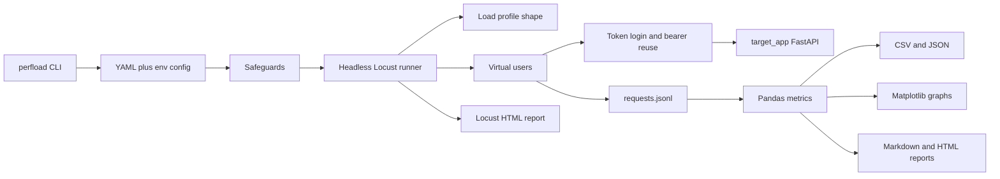
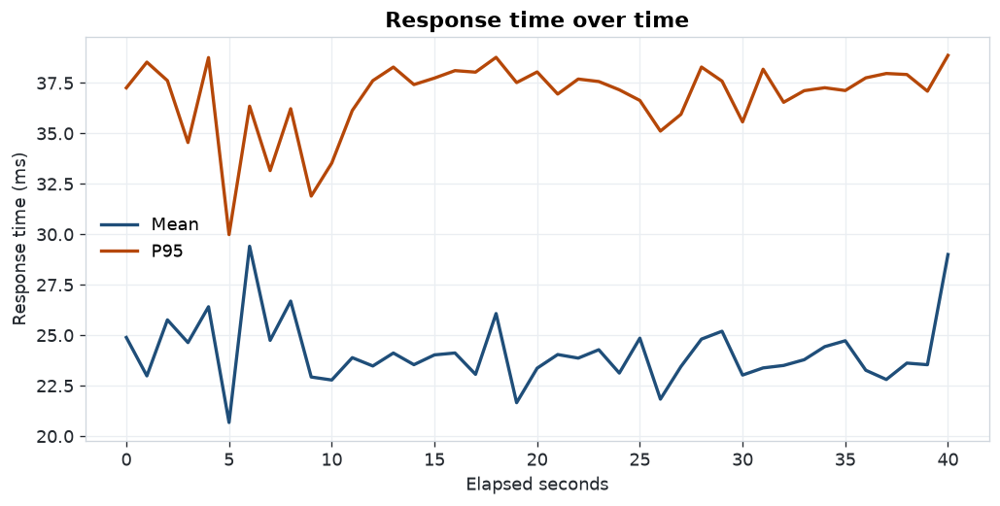
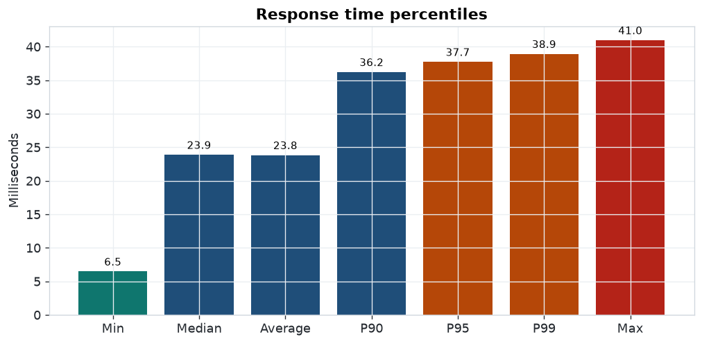
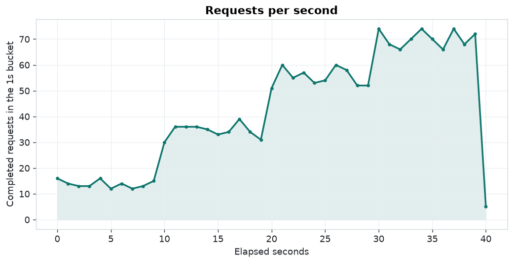
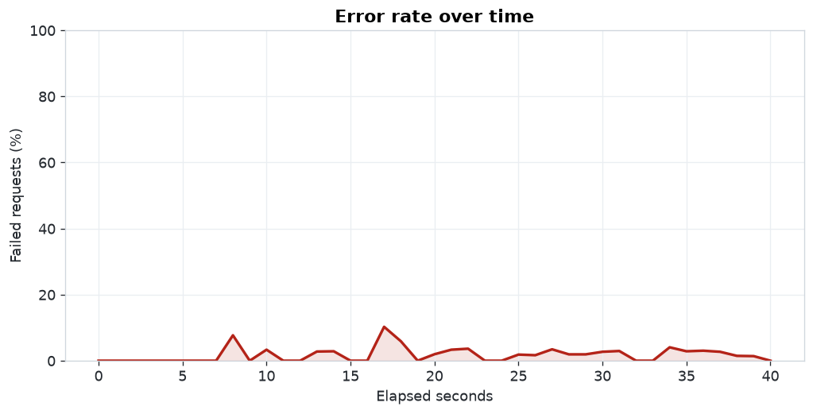

# perfload

Safety-first Python performance and load testing framework. It drives [Locust](https://locust.io/) virtual users against an allowlisted target, checks every response, and writes CSV, JSON, Matplotlib charts, a Markdown report, and an HTML report.

The default target is a small FastAPI app in this repository. The framework refuses public third-party hosts, and it refuses any other non-local host unless you explicitly confirm that you are authorized to test it.

[](https://github.com/hassanmehmoodd/python-load-testing-framework/actions/workflows/ci.yml)
[](https://www.python.org/)
[](https://locust.io/)
[](https://docs.astral.sh/ruff/)
[](LICENSE)

Built by [Hassan Mehmood](https://github.com/hassanmehmoodd), Senior SQA Automation Engineer.

## Safety

Load testing someone else's system without permission is harmful. This repository is set up so the easy path is a local demo.

- The shipped target listens on `127.0.0.1` only. Binding any other address requires `TARGET_ALLOW_REMOTE_BIND=yes`.
- Allowlist default: `localhost`, `127.0.0.1`, `::1`.
- User count and spawn rate have a configured cap (`25` users, `10` users/second in the shipped YAML) and a lower absolute cap in code (`50` users, `15` users/second). A config file cannot raise the absolute cap.
- Duration must be between 5 and 600 seconds. The endurance profile ships at 45 seconds on purpose.
- Hosts on the public denylist (including `github.com`, `google.com`, `linkedin.com`, and the other suffixes in `src/perfload/constants.py`) are always rejected. `--acknowledge-authorization` does not override that list.
- Any other host needs that flag or `PERFLOAD_ACKNOWLEDGE_AUTHORIZATION=yes`. Setting it is a statement that you own the system or have written permission to test it.
- The Locust process repeats the same checks before it sends traffic. Starting Locust by hand without `perfload run` still goes through them.

Do not point this tool at production systems you do not own. Do not use it against public websites, shared staging, or a third-party API.

## Architecture



Virtual users are Locust greenlets: one greenlet per user, so `--users` is the concurrency level. A `LoadTestShape` changes that count over time for ramp, stress, spike, and endurance. Each user logs in once, keeps the bearer token, and runs GET, POST, PUT, PATCH, and DELETE tasks. `catch_response` checks status codes and JSON bodies. Failures are grouped by HTTP status or exception type.

## Layout

```text
src/perfload/          CLI, safeguards, Locust file, metrics, charts, reports
target_app/            Local FastAPI catalog with auth and fault injection
config/                Default, smoke, and per-profile YAML
config/profiles/       constant, ramp, stress, spike, endurance
tests/                 pytest suite
reports/samples/       Report and charts from the run documented below
.github/workflows/     Ruff, pytest, and a localhost smoke load test
```

## Install

Python 3.11 or newer.

```bash
python -m venv .venv
source .venv/bin/activate
pip install -e ".[dev]"
```

Copy `.env.example` to `.env` if you want the same variable names in a local shell. The demo username `demo` and password `demo-pass` are local fixtures, not secrets.

## Demo target

Terminal 1:

```bash
python -m uvicorn target_app.app:app --host 127.0.0.1 --port 8000
```

| Method | Path | Auth | Notes |
| --- | --- | --- | --- |
| GET | `/health` | no | Liveness. Fault injection does not apply. |
| POST | `/api/v1/auth/login` | no | Returns a bearer token. Random errors skip this path. |
| GET | `/api/v1/auth/me` | bearer | Proves the token is reused. |
| GET | `/api/v1/items` | bearer | List. |
| POST | `/api/v1/items` | bearer | Create. |
| GET | `/api/v1/items/{id}` | bearer | Read one. |
| PUT | `/api/v1/items/{id}` | bearer | Replace. |
| PATCH | `/api/v1/items/{id}` | bearer | Partial update. |
| DELETE | `/api/v1/items/{id}` | bearer | Delete. |

Optional fault injection, read on each request:

| Variable | Effect |
| --- | --- |
| `TARGET_LATENCY_MS` | Fixed extra delay, except on `/health`. Capped at 5000 ms. |
| `TARGET_LATENCY_JITTER_MS` | Random extra delay from 0 through this value. |
| `TARGET_ERROR_RATE` | Chance of HTTP 500, from 0 to 1. Skips `/health` and login. |
| `X-Inject-Latency-Ms` | Per-request extra delay header. |
| `X-Inject-Status` | Per-request forced status from 400 through 599. |

Open `http://127.0.0.1:8000/docs` for the interactive schema.

## Run a profile

Terminal 2, from the repository root. Each command writes `report.md`, `report.html`, `locust-report.html`, CSV, JSON, and `graphs/` under the output directory.

```bash
perfload check-target --config config/default.yaml

perfload run --config config/profiles/constant.yaml
perfload run --config config/profiles/ramp.yaml
perfload run --config config/profiles/stress.yaml
perfload run --config config/profiles/spike.yaml
perfload run --config config/profiles/endurance.yaml
```

Keep a run instead of overwriting `reports/latest`:

```bash
perfload run --config config/profiles/spike.yaml --output reports/spike
```

Override the shape, users, spawn rate, or duration without editing YAML. Values still have to sit inside the caps.

```bash
perfload run --config config/default.yaml --profile stress --users 12 --spawn-rate 3 --duration 30
```

What each profile does:

| Profile | Shape |
| --- | --- |
| `constant` | Hold the configured user count for the whole duration. |
| `ramp` | Step through 25%, 50%, 75%, then 100% of the users. |
| `stress` | Climb to the peak and hold it for the last 40% of the run. |
| `spike` | Baseline at 20% of users, jump to the peak, return to baseline. |
| `endurance` | Reach the peak in the first 15%, then hold. Shipped duration is 45 seconds. |

GitHub Actions uses `config/smoke.yaml`: constant profile, 5 users, spawn rate 1, 25 seconds, localhost only, then `perfload validate --strict-success`.

## Configuration

YAML is the base. Environment variables override it. CLI flags override both.

| Key | Meaning | Shipped default |
| --- | --- | --- |
| `target.base_url` | Origin only, no path. `PERFLOAD_BASE_URL` | `http://127.0.0.1:8000` |
| `target.auth.username` / `password` | Demo login. `PERFLOAD_USERNAME`, `PERFLOAD_PASSWORD` | `demo` / `demo-pass` |
| `safeguards.max_users` | Cap for this file. Cannot exceed 50. | `25` |
| `safeguards.max_spawn_rate` | Cap in users/second. Cannot exceed 15. | `10` |
| `safeguards.allowed_hosts` | Hostnames that may be tested with no acknowledgement. | localhost, 127.0.0.1, ::1 |
| `load.profile` | `constant`, `ramp`, `stress`, `spike`, `endurance`. `PERFLOAD_PROFILE` | see the profile file |
| `load.users` | Peak virtual users. `PERFLOAD_USERS` | see the profile file |
| `load.spawn_rate` | Users started or stopped per second. `PERFLOAD_SPAWN_RATE` | see the profile file |
| `load.duration_seconds` | Shape length. `PERFLOAD_DURATION` | 30 to 45 in the shipped profiles |
| `load.wait_min_seconds` / `wait_max_seconds` | Think time between tasks. | `0.05` / `0.2` |
| `output.directory` | Report directory. `PERFLOAD_OUTPUT_DIR` or `--output` | `reports/latest` |

Acknowledgement, when you really are allowed to test a non-listed host you own:

```bash
perfload run --config config/default.yaml --base-url http://10.0.0.8:8000 --acknowledge-authorization
```

## Metrics

The custom report is computed from the request log with pandas. Locust's own HTML report is saved beside it. Locust's percentile table is an approximation; the numbers below use `Series.quantile` with linear interpolation. Latency stats include failed requests. Requests per second and throughput divide totals by the runner wall clock, not by the sum of response times.

| Metric | Definition |
| --- | --- |
| Total requests | Completed calls, including login. |
| Successful / failed | Locust success versus `catch_response` failure or an exception. |
| Error percentage | Failed / total × 100. |
| Average, median, P90, P95, P99, min, max | Response time in milliseconds. |
| Requests per second | Total requests / wall-clock seconds. |
| Throughput | Sum of response body bytes / wall-clock seconds. This is payload throughput, not NIC bandwidth. |

Errors are bucketed as `http_status` (the status code), `validation` (unexpected JSON), or `exception` (the exception class, such as a connection error).

## Sample report

This run was executed in this workspace against the in-repo API. It is not a synthetic table.

- When: `2026-11-08T17:05:41.904657+00:00` to `2026-11-08T17:06:22.472882+00:00`
- Where: Linux 6.12.113+ x86_64, glibc 2.39, CPython 3.12.3, Locust 2.47.0, 4 CPUs, one uvicorn worker on `127.0.0.1:8000`
- Profile: `ramp`, 10 users, spawn rate 2.0, requested 40 seconds, wall clock 40.57 seconds
- Target fault injection for that process: `TARGET_LATENCY_MS=5`, `TARGET_LATENCY_JITTER_MS=30`, `TARGET_ERROR_RATE=0.02`
- Command: `perfload run --config config/profiles/ramp.yaml --output reports/samples`
- Source file: [`reports/samples/summary.json`](reports/samples/summary.json)
- Full write-up: [`reports/samples/report.md`](reports/samples/report.md) and [`reports/samples/report.html`](reports/samples/report.html)
- Locust's report from the same run: [`reports/samples/locust-report.html`](reports/samples/locust-report.html)

The shape stepped 2, then 5, then 8, then 10 users. Locust logged those transitions. All 36 failures were injected HTTP 500 responses. Login recorded 0 failures because random injection skips that path.

| Metric | Value |
| --- | ---: |
| Total requests | 1741 |
| Successful | 1705 |
| Failed | 36 |
| Error percentage | 2.07% |
| Average response time (ms) | 23.82 |
| Median response time (ms) | 23.87 |
| P90 (ms) | 36.22 |
| P95 (ms) | 37.73 |
| P99 (ms) | 38.92 |
| Min response time (ms) | 6.47 |
| Max response time (ms) | 40.96 |
| Requests per second | 42.915 |
| Throughput (response bytes/s) | 205608.0 |

List responses grow during the run because the demo catalog is in memory and the users keep creating items. That is why payload throughput is high relative to the small JSON objects returned by create and update.

| Endpoint | Total | Failed | Error % | Avg ms | Median ms | P95 ms | RPS |
| --- | ---: | ---: | ---: | ---: | ---: | ---: | ---: |
| GET /api/v1/items | 479 | 8 | 1.67% | 23.73 | 23.43 | 37.49 | 11.807 |
| POST /api/v1/items | 368 | 10 | 2.72% | 23.40 | 23.78 | 37.37 | 9.071 |
| GET /api/v1/items/:id | 285 | 5 | 1.75% | 24.04 | 24.13 | 37.74 | 7.025 |
| PATCH /api/v1/items/:id | 202 | 3 | 1.49% | 24.72 | 25.00 | 38.16 | 4.979 |
| PUT /api/v1/items/:id | 189 | 3 | 1.59% | 23.19 | 22.64 | 38.14 | 4.659 |
| GET /api/v1/auth/me | 120 | 5 | 4.17% | 24.00 | 24.64 | 36.80 | 2.958 |
| DELETE /api/v1/items/:id | 88 | 2 | 2.27% | 24.26 | 24.73 | 37.48 | 2.169 |
| POST /api/v1/auth/login | 10 | 0 | 0.00% | 25.38 | 24.28 | 35.87 | 0.246 |









Re-running the same command will not reproduce these figures exactly. Jitter and the 2% injected error rate are random, and the in-memory catalog starts from the seed data again only when the API process restarts.

## Tests

```bash
ruff check .
pytest
```

The suite covers config parsing and override order, host allow and deny rules, user and spawn caps, profile stage plans, percentile math, error categories, response checks, CSV/JSON/HTML/Markdown output, chart files, and the demo API (login, CRUD, auth failures, latency, and injected errors).

Continuous integration on push, pull request, and `workflow_dispatch` runs Ruff, pytest, the 25-second localhost smoke test, and uploads the smoke report as an artifact. Concurrency is cancelled in progress. Pip is cached.

## Author

**Hassan Mehmood** — Senior SQA Automation Engineer

- GitHub: [https://github.com/hassanmehmoodd](https://github.com/hassanmehmoodd)
- LinkedIn: [https://www.linkedin.com/in/hassan-mehmood-hm2/](https://www.linkedin.com/in/hassan-mehmood-hm2/)

## License

MIT. Copyright 2026 Hassan Mehmood. See [LICENSE](LICENSE).
