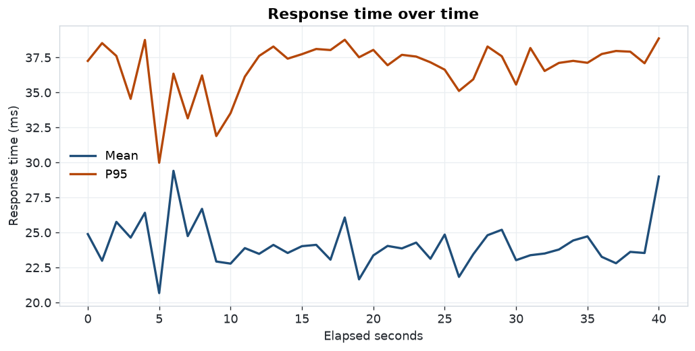
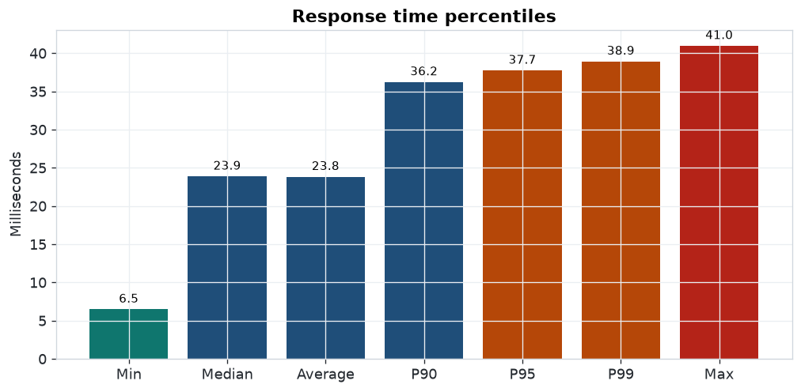
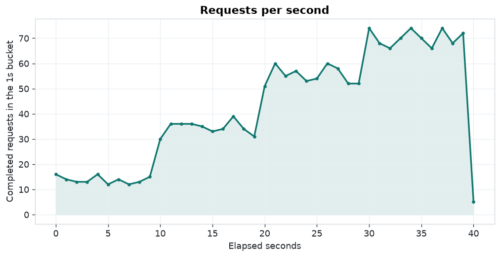
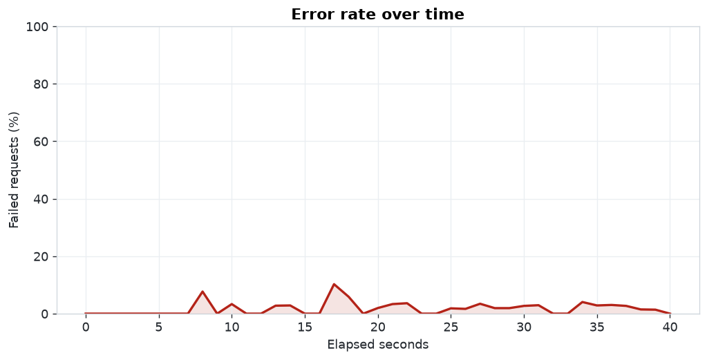

# Performance test report

Generated by perfload 1.0.0.

## Run

- Profile: `ramp` — Step the user count up to the target across the run (ramp-up).
- Target: `http://127.0.0.1:8000`
- Virtual users: 10
- Spawn rate: 2.0 users/second
- Requested duration: 40s
- Wall clock: 40.57s
- Started: 2026-11-08T17:05:41.904657+00:00
- Finished: 2026-11-08T17:06:22.472882+00:00
- Python: 3.12.3
- Platform: Linux-6.12.113+-x86_64-with-glibc2.39
- Locust: 2.47.0
- Concurrency: locust gevent virtual users (one greenlet per user)

### Stage plan

| Until (s) | Users | Spawn rate |
| ---: | ---: | ---: |
| 10.0 | 2 | 2.0 |
| 20.0 | 5 | 2.0 |
| 30.0 | 8 | 2.0 |
| 40.0 | 10 | 2.0 |

## Metrics

Latency percentiles include every completed request. Requests per second and throughput divide totals by the runner wall clock. Percentiles use pandas linear interpolation.

| Metric | Value |
| --- | ---: |
| Total requests | 1741 |
| Successful | 1705 |
| Failed | 36 |
| Error percentage | 2.07% |
| Average response time (ms) | 23.82 |
| Median response time (ms) | 23.87 |
| P90 (ms) | 36.22 |
| P95 (ms) | 37.73 |
| P99 (ms) | 38.92 |
| Min response time (ms) | 6.47 |
| Max response time (ms) | 40.96 |
| Requests per second | 42.915 |
| Throughput (response bytes/s) | 205608.0 |

## Endpoints

| Endpoint | Total | Failed | Error % | Avg ms | Median ms | P95 ms | RPS |
| --- | ---: | ---: | ---: | ---: | ---: | ---: | ---: |
| GET /api/v1/items | 479 | 8 | 1.67% | 23.73 | 23.43 | 37.49 | 11.807 |
| POST /api/v1/items | 368 | 10 | 2.72% | 23.40 | 23.78 | 37.37 | 9.071 |
| GET /api/v1/items/:id | 285 | 5 | 1.75% | 24.04 | 24.13 | 37.74 | 7.025 |
| PATCH /api/v1/items/:id | 202 | 3 | 1.49% | 24.72 | 25.00 | 38.16 | 4.979 |
| PUT /api/v1/items/:id | 189 | 3 | 1.59% | 23.19 | 22.64 | 38.14 | 4.659 |
| GET /api/v1/auth/me | 120 | 5 | 4.17% | 24.00 | 24.64 | 36.80 | 2.958 |
| DELETE /api/v1/items/:id | 88 | 2 | 2.27% | 24.26 | 24.73 | 37.48 | 2.169 |
| POST /api/v1/auth/login | 10 | 0 | 0.00% | 25.38 | 24.28 | 35.87 | 0.246 |

## Errors

| Category | Key | Count | Share of requests |
| --- | --- | ---: | ---: |
| http_status | 500 | 36 | 2.07% |

## Graphs

### Response time over time

### Response time percentiles

### Requests per second

### Error rate over time

Locust's own HTML report is `locust-report.html` in this directory.
